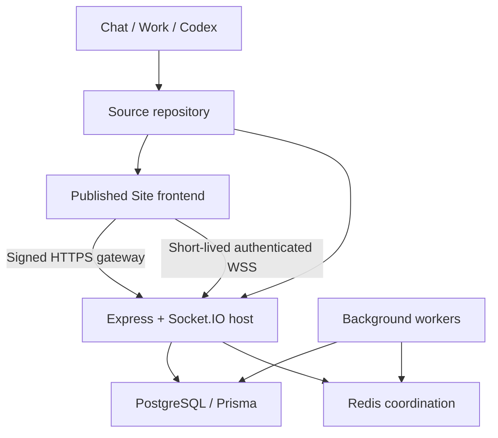

# IRMA Support Command Center

Fresh React/Vinext frontend for ChatGPT Sites, plus a separate Node.js/Express API, PostgreSQL/Prisma and Redis-capable workers. The client prototype informed the layout; the supplied requirements determine the SLA values.

**Deployment boundary:** the Site hosts the frontend and signed HTTP gateway. Express, PostgreSQL, workers and Socket.IO require external hosting. Until configured, the frontend truthfully displays “Backend connection pending”; it does not manufacture tickets or successful chat submissions. Dashboard preview changes no permissions.

## Connections

The ChatGPT development workspace and this conversation provide requirements and source access. Application workspaces are PostgreSQL membership boundaries. The customer conversation is persisted application chat. Separate ChatGPT conversations do not automatically share configuration or credentials.

Project ID: `appgprj_6ac4df9a7fd08191b3840ea0c5c99b43`. Application workspace default: `irma`. Keep these distinct. Track the Site ID, source commit, API origin, deployment version and secret names in handoffs; never include secret values.

## Local setup

Requires Node 24, pnpm 11, PostgreSQL 17, and optional Redis 7. Frontend and backend have independent lockfiles.

1. Install root dependencies with `node scripts/install-ci.mjs`. Install backend dependencies with `cd backend` then `pnpm install --frozen-lockfile` and `pnpm exec prisma generate`.
2. Copy `backend/.env.example` to `backend/.env`. Set the PostgreSQL URL and independently generated gateway/socket secrets of at least 32 characters. Use `node -e "console.log(require('crypto').randomBytes(32).toString('hex'))"` for each secret.
3. Export backend configuration in your process manager, or run commands with `node --env-file=.env`. Run `node --env-file=.env node_modules/prisma/build/index.js migrate deploy` from backend.
4. Run `node --env-file=.env src/server.js` and, separately, `node --env-file=.env src/worker.js` from backend. Do not embed workers in frontend requests.
5. Configure frontend server environment from root `.env.example`. `BACKEND_URL` is the API HTTPS origin; `GATEWAY_SECRET` must match the backend; `WORKSPACE_ID=irma`. Development mode also permits HTTP to loopback addresses, for example `http://127.0.0.1:4100`.
6. Run `pnpm dev`. For production build use `pnpm build`. Backend unit tests: `pnpm test`; development persistence integration tests: `pnpm test:integration`.

Safe seed is optional: `node --env-file=.env prisma/seed.js`. It refuses production and creates example.test identities only. Those identities do not authenticate as real Site visitors.

## Bootstrap and permissions

### Password sign-in

Set frontend `AUTH_MODE=password` and backend `ENABLE_PASSWORD_AUTH=true` to use the standalone login flow. This disables the frontend's ChatGPT/mock identity path; leave the settings at their example defaults to retain hosted ChatGPT sign-in. Apply all Prisma migrations before enabling password authentication.

- Customer sign-in: `/login`; customer registration: `/register`.
- Staff sign-in: `/admin/login`. Only existing agent, supervisor, or admin memberships can enter this portal. Registration never accepts a role and always creates a customer in the default workspace.
- The account menu provides **Sign out**. Sessions expire after 12 hours and are revoked on logout. Use separate browser profiles or a private window to test customer and staff concurrently.
- Passwords use salted scrypt hashes. Only hashes of random session tokens are stored in PostgreSQL; cookies are HttpOnly, SameSite=Lax, and Secure on HTTPS. Password reset and email verification are not included.
- For local development only, run `node --env-file=.env prisma/local-accounts.js` from `backend` to create a customer and administrator. Random credentials are saved to ignored `.sites-runtime/local-accounts.json`. The script refuses to overwrite existing credentials or run outside development. Existing users and tickets are preserved.

The gateway keeps its shared secret server-side. Authentication endpoints require the gateway secret; role and membership checks run in the backend for every authenticated request. The local configuration uses `http://127.0.0.1:5173` for the frontend and `http://127.0.0.1:4100` for the API.

Sign in to the Site and open the account menu to read your Site-scoped identity ID. Configure that exact ID as `BOOTSTRAP_ADMIN_SUB`; no first visitor is automatically administrator. On that visitor’s first authenticated API request, the workspace and admin membership are created. Remove bootstrap configuration afterward. Default `ALLOW_CUSTOMER_SIGNUP=false`; provision users using admin invitations with their actual Site IDs. Invitations create memberships, not outgoing email invitations. Enable customer signup only when appropriate for your workspace.

Visitor access to a Site never grants agent/admin rights. Roles and support entitlements come from database memberships, not browser payloads. All current staff can access the tickets in their application workspace; finer queue-specific staff permissions are an extension (see coverage).

Configure the business calendar before live intake. The labelled development default is Asia/Kolkata, Monday–Friday, 09:00–18:00, no holidays. Save administrator settings to confirm it.

## Hosting and deployment

### Vercel frontend with a hosted API

`vercel.json` selects the standard Next.js build (`pnpm build:vercel`). The existing `pnpm dev` / `pnpm build` scripts retain the Vinext/Cloudflare workflow. Server environment access is selected by the build, so no backend secret is exposed as a browser-public variable.

Set Vercel server environment variables `AUTH_MODE=password`, `BACKEND_URL` (the API's HTTPS origin), `GATEWAY_SECRET`, and `WORKSPACE_ID=irma`. A localhost backend or database cannot serve a cloud deployment.

The backend remains a persistent Node.js service with WebSockets, a separate worker, and PostgreSQL. For Railway, use `/backend` as the root directory of both services. The API's config file is `/backend/railway.toml`; the worker's is `/backend/railway-worker.toml`. Deploy the API and its migration before the worker. Provision PostgreSQL in the same project and reference its private database URL. Mount persistent storage at `UPLOAD_DIRECTORY` and ensure the container's `node` user has write access.

On both backend services, set `NODE_ENV=production`, `ENABLE_PASSWORD_AUTH=true`, `DATABASE_URL`, `GATEWAY_SECRET`, a separate `SOCKET_SECRET`, `DEFAULT_WORKSPACE_ID=irma`, `SITE_ORIGIN` (the exact Vercel production origin), and `SOCKET_PUBLIC_URL` (the public API HTTPS origin). One API instance can run without Redis; multiple instances require Redis and shared attachment storage.

For an empty hosted database, provision the first administrator once using `node prisma/create-admin.js`, with `PROVISION_ADMIN_EMAIL`, `PROVISION_ADMIN_NAME`, and `PROVISION_ADMIN_PASSWORD` supplied privately in that process's environment. Remove those provisioning variables afterward. The command refuses to overwrite an existing password account. Customers can then register through `/register`.

Local `.env` files, account credentials, database backups, uploads, dependency directories, and local tool state are excluded from Git and Vercel uploads. Do not upload a local development database or reuse local demo passwords as a production bootstrap.

The Site runtime is a Cloudflare Worker with outbound HTTP; the required Express/Prisma/PostgreSQL stack runs on a separate container-capable host. PostgreSQL remains private. No D1 or second application ORM is used.

Deploy backend Dockerfile or the root Compose stack. Set `POSTGRES_PASSWORD` in the shell for Compose, and set backend DATABASE_URL to `postgresql://irma:<password>@postgres:5432/irma_support?connection_limit=10`. Run `docker compose up -d --build`. PostgreSQL and Redis have no public ports. API binds localhost:4100 on the Docker host; put a TLS reverse proxy in front that supports WebSocket upgrades. Set production `SITE_ORIGIN` to the exact published Site origin and `SOCKET_PUBLIC_URL` to your backend HTTPS origin. API REST and Socket.IO share the same listener.

Use separate deploy stages for backups, migration, API and worker rollout. Set backend `NODE_ENV=production`; provide secrets through the host secret manager. Set the frontend server runtime variables in Sites settings: `BACKEND_URL`, `GATEWAY_SECRET`, `WORKSPACE_ID`. Do not set these as browser-public variables. The Site signs short-lived claims for the backend. Backend socket-session responses provide separate 120-second tokens, renewed by the client.

Horizontally scaled APIs require Redis for event distribution/rate limits and a shared private attachments volume mounted consistently at UPLOAD_DIRECTORY. The initial implementation uses filesystem storage; an object-storage adapter is not included. Socket.IO is websocket-only, so the load balancer must support long-lived upgrades. Size PostgreSQL pools across all replicas to database capacity. Readiness: `/health/ready`; liveness: `/health/live`. Structured logs omit message contents and secrets.

Rollback application images/source to the previous version. Initial migration is additive; do not automatically drop tables for rollback. Use tested database backups and forward corrective migrations. Keep API and schema compatibility during deployments. Audit changes and persisted jobs survive worker restarts.

## Providers

SMTP: configure SMTP_HOST/PORT/USER/PASS/FROM. Email is disabled when missing. Delivery is at-least-once; stable Message-ID helps deduplication but cannot guarantee exactly-once delivery across SMTP crash boundaries.

Inbound adapter: POST `/integrations/inbound` with timestamp and HMAC headers documented in `docs/contracts.md`; configure INBOUND_SECRET. This is a normalized signed webhook adapter, not a complete Gmail/SES/SendGrid connector. An external provider must normalize its events and authenticate upstream signatures.

Scanner: SCANNER_URL receives raw bytes with content type. Successful 2xx means accepted; errors reject upload. Without it, uploads are explicitly UNSCANNED. Production malware protection and quarantine remain deployment requirements. Only PNG, JPEG, PDF and UTF-8 plain text are allowed, maximum 5 MiB each; downloads enforce ticket/tenant/private-note access.

## Verification and remaining work

See [coverage](docs/coverage.md), [contracts](docs/contracts.md), [business rules](docs/business-rules.md) and [verification](docs/verification.md). The implementation is not represented as production-ready. Native PostgreSQL concurrency, multi-instance Redis, SMTP/provider delivery, browser E2E, load testing and hosted API/WSS verification require infrastructure and further checks.
